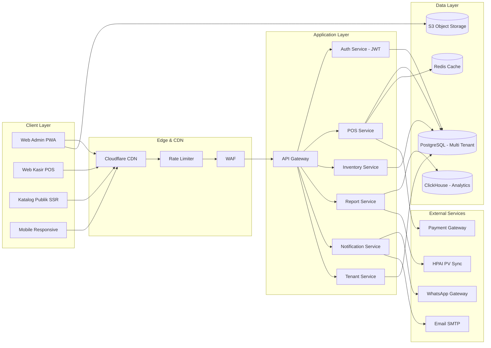
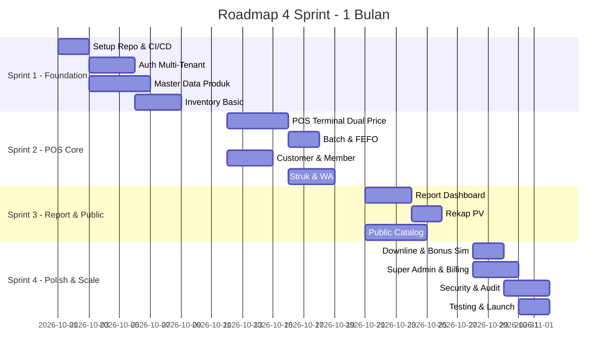

# 📘 PRD v2.0 — Web Mini POS & Inventaris HNI

## Multi-Tenant SaaS Platform untuk Jaringan Stokis/Agen HPAI

> **Version:** 2.0  
> **Status:** Draft → Ready for Development  
> **Last Updated:** 2026-10-02  
> **Owner:** Product Team

---

## 1. Executive Summary

### 1.1 Latar Belakang

Saat ini Toko/Stokis HNI (HPA Network International) dikelola secara manual atau menggunakan spreadsheet. Dengan jumlah member HNI yang terus bertambah dan kompleksitas perhitungan PV, bonus, serta jaringan downline, dibutuhkan sistem POS yang tidak hanya single-user, tetapi **multi-tenant SaaS** yang dapat digunakan oleh banyak stokis/agen HNI di seluruh Indonesia.

### 1.2 Visi Produk

Menjadi **platform POS + Inventaris + Manajemen Jaringan HNI** yang:

- Digunakan oleh **ratusan stokis HNI** secara bersamaan (multi-tenant).
- Mendukung **struktur jaringan downline** (upline → downline → member).
- Menyediakan **rekapitulasi PV otomatis** yang siap di-ekspor ke sistem HPAI.
- Menyediakan **katalog publik white-label** untuk setiap stokis.

### 1.3 Target Pengguna (Persona)

| Persona                    | Deskripsi        | Kebutuhan Utama                  |
| -------------------------- | ---------------- | -------------------------------- |
| **Owner/Admin Stokis**     | Pemilik toko HNI | Laporan laba-rugi, stok, PV      |
| **Kasir**                  | Karyawan toko    | POS cepat, cetak struk           |
| **Agen/Member HNI**        | Downline aktif   | Cek PV pribadi, riwayat belanja  |
| **Pelanggan Umum**         | Non-member       | Katalog publik, order via WA     |
| **Super Admin (Platform)** | Pengelola SaaS   | Manajemen tenant, billing, audit |

---

## 2. Arsitektur Sistem (High-Level)

**Prinsip Kunci:**

- **Multi-tenant** dengan isolasi data via `tenant_id` di setiap tabel.
- **PWA** agar bisa di-install seperti aplikasi native (terutama untuk kasir).
- **Offline-first** untuk kasir (IndexedDB + background sync).
- **Event-driven** untuk notifikasi & analytics.

---

## 3. Product Backlog & Prioritas (Epik Besar)

### 🎯 Epik Overview

| Epik | Nama                           | Sprint | Prioritas   |
| ---- | ------------------------------ | ------ | ----------- |
| E1   | Foundation & Multi-Tenant Auth | S1     | 🔴 Critical |
| E2   | Master Data Produk & Kategori  | S1     | 🔴 Critical |
| E3   | Inventory & FEFO Engine        | S1-S2  | 🔴 Critical |
| E4   | POS Terminal (Dual Price + PV) | S2     | 🔴 Critical |
| E5   | Customer & Member Management   | S2     | 🟠 High     |
| E6   | Nota, Struk & WhatsApp Gateway | S3     | 🟠 High     |
| E7   | Report & Analytics Dashboard   | S3     | 🟠 High     |
| E8   | Public Catalog White-Label     | S3     | 🟡 Medium   |
| E9   | Jaringan Downline & Rekap PV   | S4     | 🟠 High     |
| E10  | Super Admin & Billing          | S4     | 🟡 Medium   |
| E11  | Mobile PWA + Offline Mode      | S4     | 🟠 High     |
| E12  | Security, Audit & Backup       | S4     | 🔴 Critical |

---

## 4. User Stories Detail

### Epik 1 — Foundation & Multi-Tenant Auth

**US-01: Autentikasi Multi-Role**

- **As a** pengguna sistem
- **I want** login dengan role berbeda (Super Admin, Owner, Kasir, Agen)
- **So that** akses fitur dibatasi sesuai tanggung jawab
- **Acceptance Criteria:**
  - JWT access token (15 menit) + refresh token (7 hari).
  - RBAC dengan 4 role: `super_admin`, `owner`, `cashier`, `agent`.
  - Proteksi route berbasis middleware.
  - 2FA opsional untuk Owner & Super Admin.

**US-01b: Multi-Tenant Registration**

- Registrasi tenant baru (stokis) dengan subdomain otomatis: `{nama}.hnipos.id`.
- Verifikasi email + upload KTP untuk KYC.
- Pilihan paket: Free (1 kasir, 100 produk), Pro, Enterprise.

**US-01c: Invite & Team Management**

- Owner dapat mengundang Kasir via email.
- Role assignment per kasir dengan permission granular.

### Epik 2 — Master Data Produk

**US-02: CRUD Produk HNI**

- Atribut lengkap: SKU, nama, gambar, kategori, harga beli, harga member, harga non-member, PV, stok, expiry, berat, dimensi, BPOM number, komposisi.

**US-02b: Import Produk Massal (CSV/Excel)**

- Upload CSV → validasi → preview → commit.
- Support update harga massal (bulk price update) dengan simulasi dampak.

**US-02c: Varian & Bundle Produk**

- Produk dengan varian (ukuran, rasa).
- Paket bundle (misal "Paket Herbal Sehat" = 3 produk).

**US-02d: Multi-Gudang (Warehouse)**

- Satu tenant bisa punya >1 gudang (toko utama, gudang cadangan).
- Transfer stok antar gudang dengan approval.

### Epik 3 — Inventory & FEFO

**US-03: Alert Stok & Kadaluarsa**

- Threshold configurable per produk.
- Notifikasi multi-channel: in-app, email, WA.

**US-03b: Batch & FEFO Engine**

- Setiap pembelian stok dicatat sebagai **batch** terpisah dengan expiry sendiri.
- Saat penjualan, sistem otomatis memilih batch FEFO.
- Jika kasir override, wajib isi alasan (audit trail).

**US-03c: Stock Opname (Stocktake)**

- Siklus opname mingguan/bulanan.
- Input hasil hitung fisik → generate laporan selisih.
- Approval owner sebelum adjustment final.

**US-03d: Purchase Order ke HNI**

- Generate PO otomatis saat stok < reorder point.
- Tracking status PO: draft → sent → received → closed.

### Epik 4 — POS Terminal

**US-04: Terminal Kasir Dual-Price**

- Toggle Member/Non-Member → harga otomatis berubah.
- Kalkulasi real-time: subtotal, PV, diskon, pajak, kembalian.

**US-04b: Mode Offline POS**

- Kasir tetap bisa transaksi saat internet putus.
- Sinkronisasi otomatis saat online (conflict resolution).
- Indikator status koneksi + jumlah transaksi pending.

**US-04c: Split Payment & Multi Metode**

- Bayar dengan kombinasi: cash + transfer + e-wallet.
- Support QRIS dinamis (integrasi Midtrans/Xendit).

**US-04d: Hold & Resume Order**

- Simpan keranjang sebagai draft (misal pelanggan lupa bawa uang).
- Multiple holds per kasir.

**US-04e: Diskon & Promo Engine**

- Diskon per item, per transaksi, atau per kategori.
- Promo BOGO, bundling, minimum pembelian.
- Voucher code dengan batas pemakaian.

### Epik 5 — Customer & Member Management

**US-05: CRUD Pelanggan**

- Data: nama, WA, ID HNI, upline, alamat, tanggal lahir.

**US-05b: Auto-Complete & Quick Add**

- Cari pelanggan berdasarkan nama/WA/ID → auto-fill.
- Quick add dari POS tanpa keluar halaman.

**US-05c: Profil Member & Riwayat PV**

- Halaman detail member: total belanja, PV bulan ini, PV YTD, poin reward.
- Grafik tren belanja 12 bulan terakhir.

**US-05d: Struktur Jaringan Downline**

- Visualisasi tree upline → downline (maks 5 level).
- Rekap PV per leg untuk persiapan bonus HPAI.

### Epik 6 — Nota & WhatsApp

**US-06: Cetak Struk Thermal**

- Format 58mm & 80mm.
- Logo tenant + QR code untuk verifikasi.

**US-06b: WhatsApp Business API Integration**

- Bukan hanya `wa.me`, tapi WA Business API resmi.
- Template pesan terverifikasi (struk, reminder, promo).
- Broadcast promo ke member dengan opt-in.

**US-06c: E-Receipt via Email & Link**

- Struk digital dengan URL unik (`/receipt/{token}`).
- Bisa di-download PDF.

### Epik 7 — Report & Analytics

**US-07: Laporan Omset & PV**

- Filter tanggal, kasir, kategori, status member.

**US-07b: Dashboard Analytics Real-Time**

- KPI cards: omset hari ini, transaksi, rata-rata basket size, PV bulan ini.
- Grafik: penjualan per jam, per kategori, top 10 produk.

**US-07c: Laporan Laba Rugi (P&L)**

- Omset - HPP - opex (biaya operasional yang bisa di-input) = laba bersih.
- Export PDF profesional untuk pajak.

**US-07d: Rekap PV untuk HPAI**

- Format CSV siap upload ke sistem HPAI.
- Mapping kode produk HNI → PV standar.

**US-07e: Scheduled Report**

- Kirim laporan otomatis harian/mingguan/bulanan ke email owner.

### Epik 8 — Public Catalog

**US-08: Katalog Web Publik**

- Halaman `/katalog/{tenant-slug}`.
- Filter kategori, pencarian, tampilkan stok ready.

**US-08b: SEO & Open Graph**

- Meta tags otomatis, sitemap.xml, structured data (JSON-LD).
- Preview thumbnail saat share ke sosmed.

**US-08c: Order via WA dengan Keranjang**

- Pengunjung bisa tambah ke keranjang → generate link WA berisi daftar pesanan.

### Epik 9 — Jaringan & Rekap PV

**US-09: Manajemen Downline**

- Input downline langsung atau via import.

**US-09b: Bonus Simulator**

- Simulasi bonus berdasarkan struktur PV jaringan (sesuai skema HPAI).
- Bandingkan skenario: jika downline X naik level, bonus saya jadi berapa.

**US-09c: Leaderboard & Achievement**

- Ranking member berdasarkan PV bulan ini dalam satu tenant.
- Badge achievement (Bronze/Silver/Gold/Diamond).

### Epik 10 — Super Admin & Billing

**US-10: Manajemen Tenant**

- List semua tenant, status aktif/suspended, usage metrics.

**US-10b: Billing & Subscription**

- Integrasi Midtrans untuk pembayaran langganan.
- Invoice otomatis + reminder jatuh tempo.
- Dunning management (retry payment).

**US-10c: Feature Flags per Tenant**

- Aktifkan/nonaktifkan fitur tertentu per paket.
- A/B testing fitur baru.

### Epik 11 — Mobile & Offline

**US-11: PWA Installable**

- Service worker + manifest untuk install ke home screen.

**US-11b: Offline POS Mode**

- IndexedDB untuk cache produk & antrian transaksi.
- Background sync saat online.

**US-11c: Push Notification**

- Web push untuk alert stok, expiry, dan promo.

### Epik 12 — Security & Audit

**US-12: Audit Log**

- Catat semua aksi kritikal: login, edit harga, hapus produk, refund.

**US-12b: Backup Otomatis**

- Daily backup ke S3 + retensi 30 hari.
- Restore point-in-time untuk database.

**US-12c: Rate Limiting & Anti-Fraud**

- Deteksi anomali transaksi (misal: 100 transaksi/menit dari 1 kasir).
- Alert ke owner jika ada aktivitas mencurigakan.

---

## 5. Non-Functional Requirements

| Kategori          | Requirement                                            |
| ----------------- | ------------------------------------------------------ |
| **Performance**   | Response API < 300ms (p95), POS render < 1s            |
| **Scalability**   | Support 500 tenant aktif, 10.000 transaksi/hari/tenant |
| **Availability**  | Uptime 99.5%, RTO 1 jam, RPO 15 menit                  |
| **Security**      | OWASP Top 10 compliant, enkripsi AES-256 at rest       |
| **Compliance**    | UU PDP Indonesia, PCI-DSS untuk payment                |
| **Localization**  | Bahasa Indonesia, format Rupiah, timezone WIB/WITA/WIT |
| **Accessibility** | WCAG 2.1 Level AA                                      |

---

## 6. Tech Stack Rekomendasi

| Layer          | Teknologi                                                   |
| -------------- | ----------------------------------------------------------- |
| **Frontend**   | Next.js 14 (App Router) + TypeScript + Tailwind + shadcn/ui |
| **State**      | Zustand + React Query (TanStack)                            |
| **PWA**        | next-pwa + Workbox                                          |
| **Backend**    | NestJS (Node) atau Go (Fiber)                               |
| **Database**   | PostgreSQL 16 + Prisma ORM                                  |
| **Cache**      | Redis 7                                                     |
| **Queue**      | BullMQ (Redis-based)                                        |
| **Storage**    | S3 / Cloudflare R2                                          |
| **Analytics**  | ClickHouse (opsional) atau PostgreSQL materialized view     |
| **Auth**       | JWT + Refresh Token, opsional NextAuth                      |
| **WA**         | Fonnte / Wablas / WA Business API                           |
| **Payment**    | Midtrans / Xendit                                           |
| **Deploy**     | Docker + VPS (Hetzner/DigitalOcean) atau Vercel + Railway   |
| **Monitoring** | Sentry + Grafana + Loki                                     |
| **CI/CD**      | GitHub Actions                                              |

---

## 7. Roadmap 4 Sprint (1 Bulan)

---

## 8. KPI Keberhasilan

| Metrik                | Target Bulan 1 | Target Bulan 3 |
| --------------------- | -------------- | -------------- |
| Tenant aktif          | 3              | 25             |
| Transaksi/hari/tenant | 10             | 50             |
| Uptime                | 99%            | 99.5%          |
| Response time p95     | < 500ms        | < 300ms        |
| Bug kritis            | 0              | 0              |
| NPS Owner             | > 7            | > 8            |

---

## 9. Risk Register

| Risk                | Impact | Mitigasi                       |
| ------------------- | ------ | ------------------------------ |
| WA gateway diblokir | Tinggi | Multi-provider fallback        |
| Server down         | Tinggi | Auto-restart + monitoring 24/7 |
| Data loss           | Kritis | Daily backup + PITR            |
| Adopsi user rendah  | Sedang | Onboarding 1-on-1 + video      |
| Scope creep         | Sedang | Freeze scope setelah Day 20    |

---

## 10. Definition of Done (DoD)

Sebuah task dianggap **DONE** jika:

- [ ] Kode sudah di-merge ke `main`.
- [ ] Unit test coverage minimal 70% untuk modul tersebut.
- [ ] Lulus code review (minimal 1 reviewer).
- [ ] Berjalan di staging tanpa error.
- [ ] Dokumentasi API ter-update.
- [ ] Tidak ada bug kritis dari QA.

---

_Dokumen ini bersifat hidup — akan di-update setiap akhir sprint._
